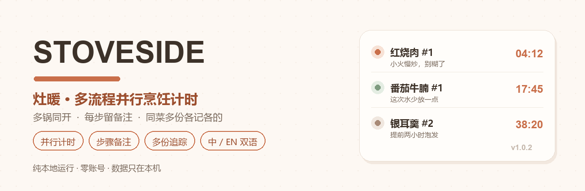
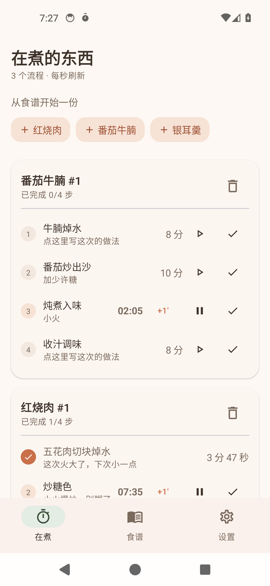
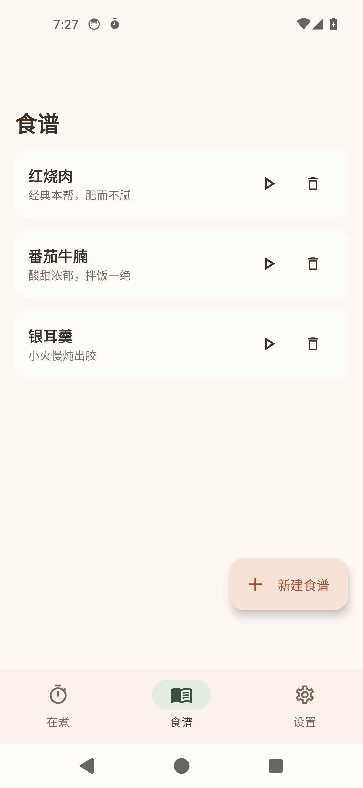
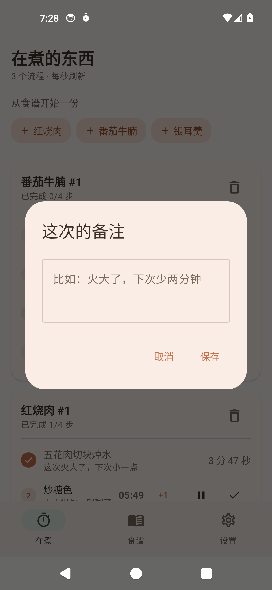
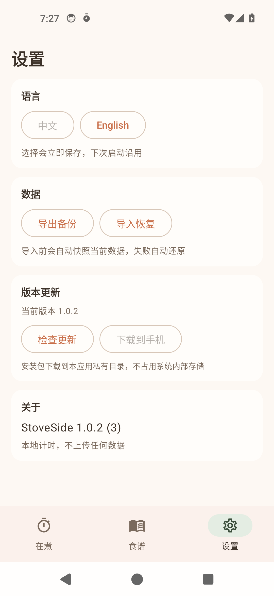

# 灶暖 · StoveSide

**多流程并行烹饪计时 · 步骤备注 · 同菜多份独立追踪 ｜ Multi-timer cooking companion for Android**

[](https://opensource.org/licenses/MIT)
[](https://kotlinlang.org/)
[](https://developer.android.com/jetpack/compose)
[](https://developer.android.com/training/data-storage/room)
[](https://developer.android.com/about/versions/nougat)
[](https://github.com/Levanll/StoveSide/releases/latest)
[](#)

**中文** ｜ [English](README_EN.md) ｜ **[官方网站](https://levanll.github.io/StoveSide/)** ｜ [Releases](https://github.com/Levanll/StoveSide/releases)



---

## 10 秒看懂

一个 Android 上的**厨房计时器**，但它记的不是菜谱，是「现在这一刻哪口锅走到哪一步」。

把一道菜拆成带时长的步骤，一次下厨开一份「烹饪实例」。**几口锅同时在跑时，每个步骤各走各的表**，到点提醒；随手写下的「这次火大了」留在这一次里，不会污染原食谱。同一道菜今天做三份？开三个实例，**各自独立推进、各自记录**。

全部数据存在本机 Room 数据库，**无账号、无云同步**；需要换机时导出成一份 JSON，导回来即可。

---

## 核心卖点

| | 名称 | 解决什么 | 为什么重要 |
|---|---|---|---|
| ⏱ | 多流程并行计时 | 同时跑多个流程，每步独立计时 | 炖汤 40 分钟、蒸鱼 8 分钟、炒菜 3 分钟同时进行，手机不在手里也不会烧糊 |
| 📝 | 步骤备注 | 每个节点可写备注，实例内可再改 | 火候、临时替换的配料、「下次少两分钟」都记在当场 |
| 🍲 | 同菜多份追踪 | 同一食谱开多个实例，互不影响 | 一次做两锅、反复试做，进度和备注不会串到一起 |
| 📋 | 粘贴文本拆分 | 粘贴菜谱原文，自动切步骤并识别时长 | 省掉逐条手打，解析结果可继续编辑 |
| 🌏 | 中英双语 | 界面与文案双语言，选择持久化 | 同一台手机换语言不用重装，下次启动沿用 |
| 💾 | 导出 / 导入 | 全量数据单文件备份，跨版本兼容 | 换机、重装、回滚都靠它 |
| 🔄 | 应用内更新 | 检查新版本、下载、确认后安装 | 不跳应用商店也能升级 |

---

## 快速开始

### 1. 下载安装

到 [Releases](https://github.com/Levanll/StoveSide/releases/latest) 下载最新 APK，安装时允许「安装未知来源应用」。

### 2. 建一份食谱

「食谱」页点右下角 `＋ 新建食谱`。可以直接粘贴一段菜谱原文，点「解析预览」看它识别出的步骤与时长，确认无误后「采用 N 步」。

### 3. 开火

回到「在煮」页，点顶部的食谱胶囊或卡片上的 ▶。每次点都是一份**新实例**，编号自动递增（`红烧肉 #1`、`#2`）。

### 4. 做饭中

- 点步骤右侧 ▶ 开始这一步的倒计时，⏸ 暂停，`+1'` 加一分钟，✓ 标记完成并自动点亮下一步
- 点步骤标题下方的备注行，可以随时补写这次的做法
- 有计时在跑时，通知栏常驻显示「还剩多久」；到点会响铃震动

### 系统要求

- Android 7.0（API 24）及以上
- 约 9.6 MB，无需联网即可使用（仅「检查更新」需要网络）

---

## 界面预览

> 截图为真机（Android 14 模拟器）实拍，未做美化处理。

| 在煮 · 多流程并行 | 食谱 · 模板与实例 |
|---|---|
|  |  |
| *番茄牛腩 #1 与红烧肉 #1 同时推进，各自剩余时间独立倒数* | *同一份食谱可反复开火，开出的实例互不干扰* |

| 步骤备注 · 这次的做法 | 设置 · 语言 / 数据 / 更新 |
|---|---|
|  |  |
| *点步骤下方即可写这次的做法，只留在本次实例* | *语言、导出导入、检查更新都在这一页* |

---

## 能力一览

| 能力 | 说明 |
|---|---|
| 多流程并行 | 5 个以上流程同时计时，单一调度循环，互不阻塞 |
| 墙钟计时 | 到期时间存数据库，杀进程、重启、息屏都不影响准确性 |
| 到点提醒 | 前台服务 + 通知渠道，声音与震动 |
| 步骤备注 | 模板备注 + 实例备注两层，实例改动不回写模板 |
| 粘贴解析 | 中文数字、`1.5 小时`、`一个半小时`、`90 seconds`、`1h` 都能识别 |
| 双语切换 | 立即生效并写盘，下次冷启动还原 |
| 导出导入 | 单文件 JSON，导入前自动快照，失败自动还原 |
| 应用内更新 | 查 GitHub Releases，下载到应用私有目录，用户确认后调起安装器 |

---

## 为什么是「模板 + 实例」

这是整个应用的地基。两道菜同时做，如果共用一份步骤状态，就会互相踩踏；改模板又追溯改历史记录，「可追溯」就没了。

```
Recipe（食谱模板） ──< Step（模板步骤）
Recipe（食谱模板） ──< Cook（烹饪实例） ──< CookStep（实例步骤记录）
```

| | 回答什么 | 谁改它 |
|---|---|---|
| Recipe / Step | 这道菜**应当**怎么做 | 编辑食谱时 |
| Cook / CookStep | 这次**实际**怎么走的 | 开火后每次操作 |
| 备注 | 模板放经验，实例放临时 | 实例改动不回写模板 |

---

## 项目结构

```
cooking-timer/
├─ app/src/main/java/cn/levanll/stoveside/
│  ├─ data/       Room 实体、DAO、数据库与仓库
│  ├─ domain/     时间格式化、粘贴文本解析
│  ├─ service/    前台计时服务、通知
│  ├─ backup/     导出与导入、快照回滚
│  ├─ update/     应用内更新与安装
│  ├─ i18n/       中英文案
│  └─ ui/         Compose 界面与主题
├─ docs/          GitHub Pages 站点与截图
└─ scripts/       构建、发版、快照与图标脚本
```

---

## 技术栈

| 项 | 说明 |
|---|---|
| 语言 | Kotlin 1.9.24 |
| 界面 | Jetpack Compose（Material 3，Compose BOM 2024.06） |
| 存储 | Room 2.6.1 + KSP |
| 并发 | Kotlin Coroutines + StateFlow，单一 tick 循环 |
| 序列化 | Gson（导出格式） |
| 包名 | `cn.levanll.stoveside` |
| minSdk / targetSdk | 24 / 34 |
| 当前版本 | 1.0.2（versionCode 3） |

## 从源码构建

仓库自带 `scripts/build.ps1`，默认任务为 `assembleRelease`，可传入其它任务：

```powershell
./scripts/build.ps1 -Task assembleDebug

# 或者直接用 Gradle
gradle assembleRelease
```

没有 `keystore/` 时会产出 `app-release-unsigned.apk`，构建不会失败——只有需要正式签名时才需要准备该目录（它已在 `.gitignore` 中排除）。

---

## 隐私速览

| 项 | 本项目 |
|---|---|
| 账号 | 无 |
| 数据在哪 | 本机 Room 数据库 |
| 联网 | 仅「检查更新」时请求 GitHub Releases API |
| 上传 | 不上传任何用户数据 |
| 权限 | 通知（到期提醒）、振动、网络、安装未知来源应用 |

---

## 版本记录

见 [CHANGELOG.md](CHANGELOG.md)。当前版本 1.0.2。

## 文档

- [设计方案](docs/设计方案.md) — 数据模型、计时调度、解析策略
- [页面规格](docs/页面规格.md) — 三个页面的信息层级与交互约束
- [交付报告](docs/交付报告.md) — 上线结果与审查修复记录
- [安全说明](SECURITY.md) — 漏洞报告方式与发布脱敏流程

## 贡献

缺陷与建议走 [Issues](https://github.com/Levanll/StoveSide/issues)。提问题时请附：Android 版本、机型、复现步骤、期望与实际。

## 许可证

MIT © 2026 Levanll。见 [LICENSE](LICENSE)。