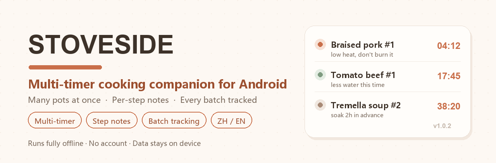
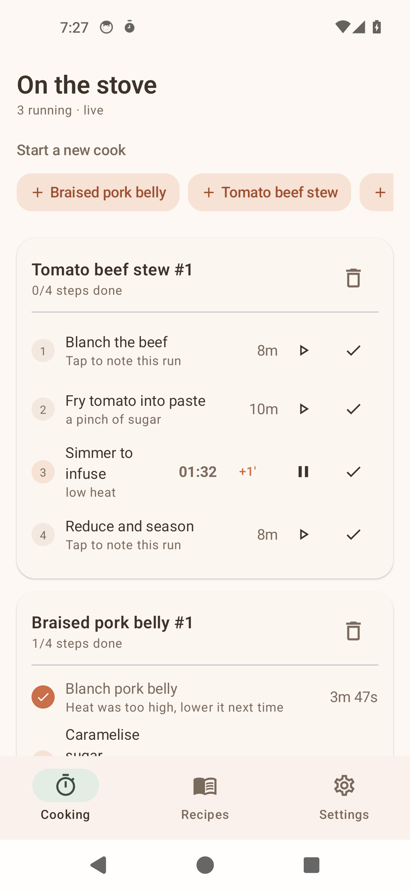
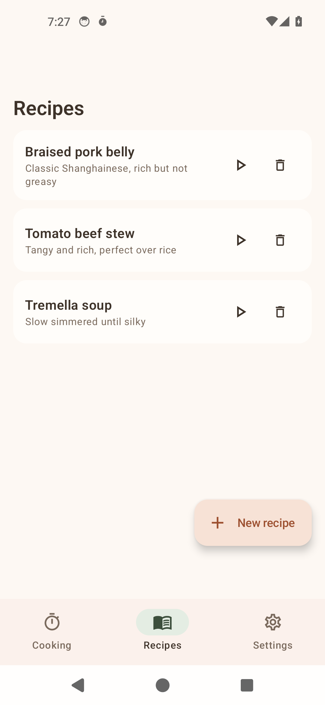
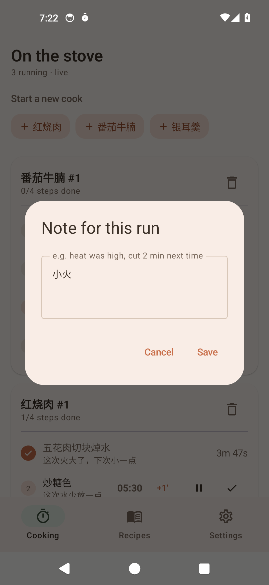
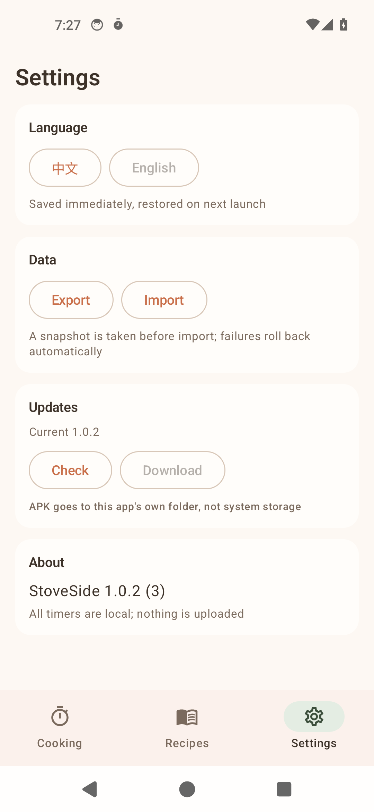

# StoveSide

**Multi-timer cooking companion · Per-step notes · Every batch tracked ｜ Android, offline-first**

[](https://opensource.org/licenses/MIT)
[](https://kotlinlang.org/)
[](https://developer.android.com/jetpack/compose)
[](https://developer.android.com/training/data-storage/room)
[](https://developer.android.com/about/versions/nougat)
[](https://github.com/Levanll/StoveSide/releases/latest)
[](#)

[中文](README.md) ｜ **English** ｜ **[Website](https://levanll.github.io/StoveSide/en/)** ｜ [Releases](https://github.com/Levanll/StoveSide/releases)



---

## The 10-second version

A **kitchen timer for Android** — but it does not remember recipes. It remembers *which pot is at which step, right now*.

Split a dish into timed steps, then start a **cooking session** for each time you actually cook. **With several pots going, every step runs its own clock** and alerts you when it is done. The note you scribble — "heat was too high this time" — stays with *this* run and never pollutes the recipe. Cooking the same dish three times tonight? Start three sessions: **each advances and records independently**.

Everything lives in a local Room database. **No account, no cloud sync.** Moving to a new phone means exporting one JSON file and importing it back.

---

## What it solves

| | Feature | What it does | Why it matters |
|---|---|---|---|
| ⏱ | Parallel timers | Many flows at once, each step timed independently | Soup 40 min, fish 8 min, stir-fry 3 min — all running while the phone is not in your hand |
| 📝 | Step notes | Every node takes a note; the session copy is editable | Heat level, substitutions, "two minutes less next time" — recorded on the spot |
| 🍲 | Batch tracking | One recipe, many live sessions, fully isolated | Two pots or repeated trials never bleed progress into each other |
| 📋 | Paste-to-steps | Paste recipe text, get editable steps with durations | No retyping line by line |
| 🌏 | Bilingual | UI and copy in Chinese and English, persisted | Switch on one device without reinstalling; restored on next launch |
| 💾 | Export / import | One-file full backup, schema-versioned | Moving devices, reinstalling, rolling back |
| 🔄 | In-app update | Check, download, confirm to install | Upgrade without the Play Store |

---

## Quick start

### 1. Install

Download the latest APK from [Releases](https://github.com/Levanll/StoveSide/releases/latest) and allow "install from unknown sources".

### 2. Create a recipe

Open **Recipes** → `+ New recipe`. You can paste a whole recipe, tap **Preview** to see the parsed steps and durations, then tap **Use N steps**.

### 3. Light the stove

Go to **Cooking** and tap a recipe pill at the top (or ▶ on a card). Every tap creates a **new session** with an increasing number (`Braised pork #1`, `#2`).

### 4. While cooking

- ▶ starts the step timer, ⏸ pauses, `+1'` adds a minute, ✓ marks it done and lights up the next step
- Tap the note line under any step to record what happened this run
- While timers run, the notification shows the time left; when a step is due you get sound and vibration

### Requirements

- Android 7.0 (API 24) or newer
- About 9.6 MB; works fully offline (only "Check for updates" needs the network)

---

## Screenshots

> Captured on a real Android 14 emulator build, no mockups.

| Cooking · parallel timers | Recipes · template vs session |
|---|---|
|  |  |
| *Tomato beef stew #1 and Braised pork belly #1 advance together, each counting down on its own* | *The same recipe can be started repeatedly; each session stays isolated* |

| Step notes · how this run went | Settings · language / data / updates |
|---|---|
|  |  |
| *Tap under any step to note this run; the note stays with this session only* | *Language, export/import and update checks all live here* |

---

## Capabilities

| Capability | Detail |
|---|---|
| Parallel flows | 5+ concurrent flows, one scheduler loop, never blocking |
| Wall-clock timing | Due times persist in the database, so process death, reboot and screen-off never skew them |
| Due alerts | Foreground service + notification channel, sound and vibration |
| Two-level notes | Template default plus session override; session edits never write back |
| Text parsing | Chinese numerals, `1.5 hours`, `一个半小时`, `90 seconds`, `1h` all recognized |
| Bilingual switch | Takes effect immediately, persists to disk, restored on cold start |
| Backup | Single JSON file; a snapshot is taken before import and restored on failure |
| In-app update | Reads GitHub Releases, downloads into app-private storage, installs only after confirmation |

---

## Why template + session

This is the foundation. If two dishes shared one set of step states they would trample each other; if editing a template rewrote history, "traceable" would be meaningless.

```
Recipe ──< Step            (the template: how this dish should be made)
Recipe ──< Cook ──< CookStep (the session: how this run actually went)
```

| | Answers | Who edits it |
|---|---|---|
| Recipe / Step | How the dish **should** be made | While editing the recipe |
| Cook / CookStep | How this run **actually** went | Every action after lighting the stove |
| Notes | Experience on the template, adjustments on the session | Session edits never write back |

---

## Project layout

```
cooking-timer/
├─ app/src/main/java/cn/levanll/stoveside/
│  ├─ data/       Room entities, DAOs, database, repository
│  ├─ domain/     time formatting, recipe text parser
│  ├─ service/    foreground timer service, notifications
│  ├─ backup/     export/import, snapshot rollback
│  ├─ update/     in-app update and installer
│  ├─ i18n/       Chinese and English strings
│  └─ ui/         Compose screens and theme
├─ docs/          GitHub Pages site and screenshots
└─ scripts/       build, release, snapshot and icon scripts
```

---

## Tech stack

| Item | Detail |
|---|---|
| Language | Kotlin 1.9.24 |
| UI | Jetpack Compose (Material 3, Compose BOM 2024.06) |
| Storage | Room 2.6.1 + KSP |
| Concurrency | Coroutines + StateFlow, single tick loop |
| Serialization | Gson (backup format) |
| Package | `cn.levanll.stoveside` |
| minSdk / targetSdk | 24 / 34 |
| Version | 1.0.4 (versionCode 5) |

## Build from source

The repo ships `scripts/build.ps1` (defaults to `assembleRelease`):

```powershell
./scripts/build.ps1 -Task assembleDebug

# or directly
gradle assembleRelease
```

Without a `keystore/` directory the build produces `app-release-unsigned.apk` instead of failing — you only need that directory for official signing (it is gitignored).

---

## Privacy at a glance

| Item | This project |
|---|---|
| Account | None |
| Where data lives | Local Room database on the device |
| Network | Only "Check for updates", which calls the GitHub Releases API |
| Uploads | No user data is ever uploaded |
| Permissions | Notifications, vibration, network, install unknown apps |

---

## Changelog

See [CHANGELOG.md](CHANGELOG.md). Current version 1.0.4.

## Docs

- [Design](docs/设计方案.md) — data model, timer scheduling, parsing strategy
- [Screen spec](docs/页面规格.md) — information hierarchy and interaction rules
- [Delivery report](docs/交付报告.md) — release results and review fixes
- [Security](SECURITY.md) — reporting and release scrubbing

## Contributing

Bugs and ideas go to [Issues](https://github.com/Levanll/StoveSide/issues). Please include Android version, device model, reproduction steps, expected and actual behaviour.

## License

MIT © 2026 Levanll. See [LICENSE](LICENSE).