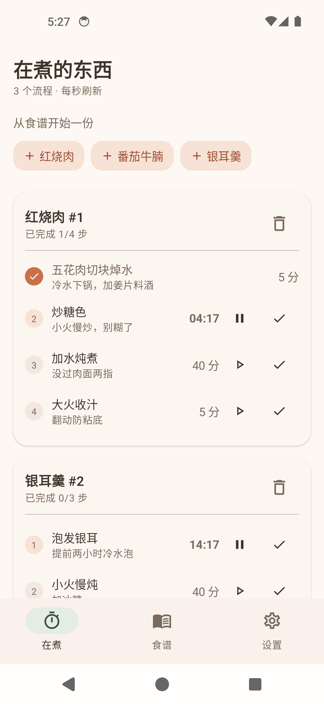
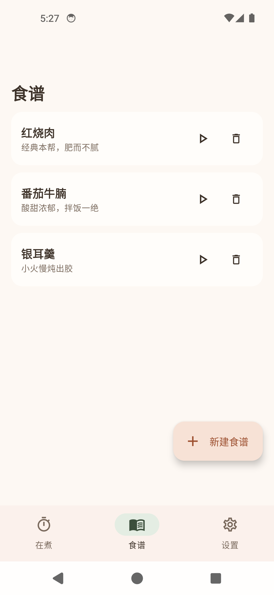
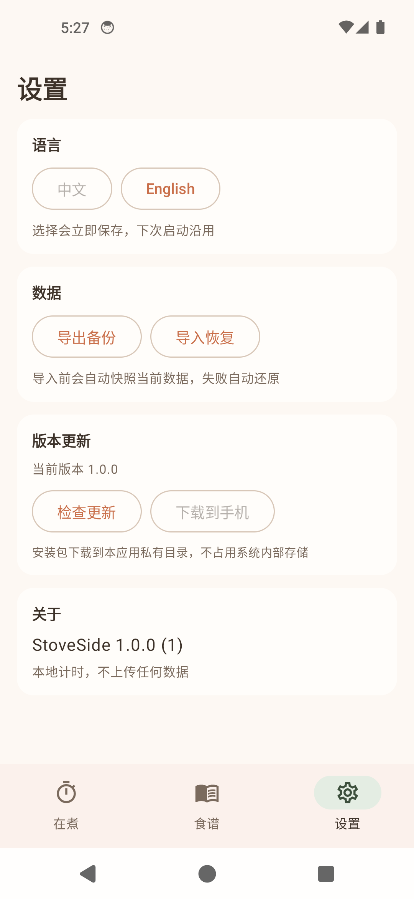

# StoveSide · 灶暖

> Several burners at once, still under control: parallel step timers, per-step notes, and separate records for every run of the same recipe.

[简体中文](README.md) ｜ **English**

[Download the latest build](https://github.com/Levanll/StoveSide/releases/latest) ｜ [GitHub repository](https://github.com/Levanll/StoveSide)

---

## What it is

StoveSide is an Android timer built for the actual moment of cooking. It is not a recipe collection manager; it solves the twenty frantic minutes when the soup is simmering, the fish is steaming, the stir-fry is on high heat and the rice is coming up — and every step still needs to be tracked, with whatever you changed on the fly written down.

Break a recipe into steps, each with its own timer. Every cooking session opens a cook instance, and the same recipe can have several instances running independently at once. Notes you jot down mid-cook stay on the instance and never leak back into the recipe template.

## Screenshots

| Cooks in progress | Recipe library | Settings |
| --- | --- | --- |
|  |  |  |

## Features

- **Parallel multi-flow timers** — Run several cooking flows at the same time, each step with its own countdown, none of them blocking the others. Remaining time is shown together, and alerts fire when a step is due.
- **Per-step notes** — Any step can carry a note: heat level, a last-minute substitution, what to change next time.
- **Multiple instances of one recipe** — The same recipe can spawn several cook instances at once, each tracking its own progress and notes — handy for two pots at a time or for repeated test runs.
- **Paste text, get steps** — Paste a block of recipe text and it is split into steps by line breaks and numbering, so nothing has to be typed in step by step.
- **Chinese and English** — The interface follows the system language and switches between Chinese and English.
- **Export and import** — All data can be exported as a backup and imported back after reinstalling or moving to a new phone.
- **In-app updates** — The app checks for a newer build on launch and can download and install the update without leaving it.

## Data model

Templates and instances are strictly separated — that is the core design of the app:

```
Recipe (template) ──< Step
Recipe (template) ──< Cook (instance) ──< CookStep (per-instance step record)
```

- **Recipe → Step**: the template only answers "how is this dish made" and can be reused indefinitely.
- **Recipe → Cook → CookStep**: every real cooking session creates a Cook, and step state plus notes live on its CookSteps.
- **Notes never write back**: anything changed during a session stays inside that session; the template stays clean.

## Look and palette

A warm cream base with clay orange, quiet rounded cards, and a minimal bowl-with-two-wisps-of-steam mark.

| Role | Value |
| --- | --- |
| Cream background | `#FDF8F3` |
| Card surface | `#FFFDFA` |
| Clay orange (primary) | `#C96F4A` |
| Deep clay | `#9C4F2F` |
| Sage green | `#7E9B80` |
| Ink text | `#3D3229` |
| Muted text | `#7A6A5D` |
| Dark mode background | `#211A16` |

Card corners sit at 16–18dp.

## Install

- Requires Android 7.0 (API 24) or newer.
- Download the latest APK from [Releases](https://github.com/Levanll/StoveSide/releases/latest) and allow installing from unknown sources when prompted.
- Installing over an existing version keeps your data. Before a major version jump, export a backup in Settings first.

## Tech stack

| Item | Value |
| --- | --- |
| Language | Kotlin |
| UI | Jetpack Compose (Material 3) |
| Persistence | Room 2.6.1 |
| Package | `cn.levanll.stoveside` |
| minSdk / targetSdk | 24 / 34 |
| Current version | 1.0.0 (versionCode 1) |

## Build from source

The repository ships `scripts/build.ps1`, defaulting to `assembleRelease`; pass another task if you need one:

```powershell
./scripts/build.ps1 -Task assembleDebug
```

The script pins both the Gradle user home and the Gradle distribution location so caches and build outputs stay off the system drive, and it invokes Gradle with `--offline --no-daemon` — dependencies must already be cached locally before the first build.

Signing configuration is read from `keystore/keystore.properties`, which is excluded in `.gitignore` and never enters version control.

## Project layout

```
cooking-timer/
├─ app/src/main/java/cn/levanll/stoveside/
│  ├─ data/      Room entities, DAOs, database and repository
│  ├─ domain/    Pure logic such as time formatting
│  ├─ service/   Foreground timer service, alarms and notifications
│  ├─ backup/    Export and import
│  ├─ update/    In-app update and installer
│  ├─ i18n/      Chinese and English copy
│  └─ ui/        Compose screens and theme
├─ docs/         GitHub Pages site and screenshots
└─ scripts/      Build and icon scripts
```

## Changelog

See [CHANGELOG.md](CHANGELOG.md). Current version 1.0.0.

## Links

- Project home: https://github.com/Levanll/StoveSide
- Downloads: https://github.com/Levanll/StoveSide/releases/latest
- Issues: https://github.com/Levanll/StoveSide/issues
